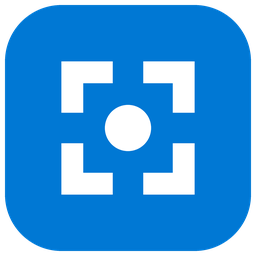
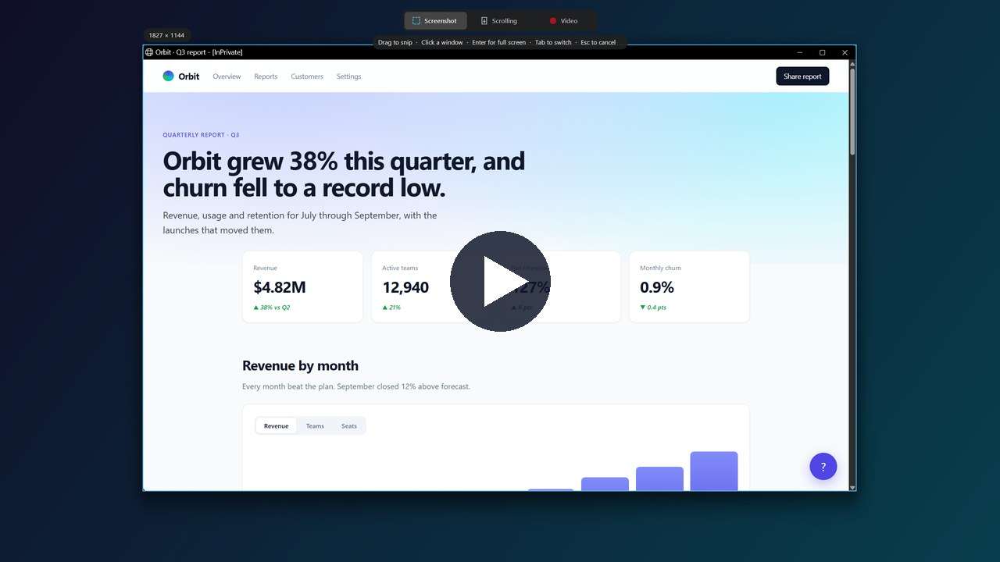
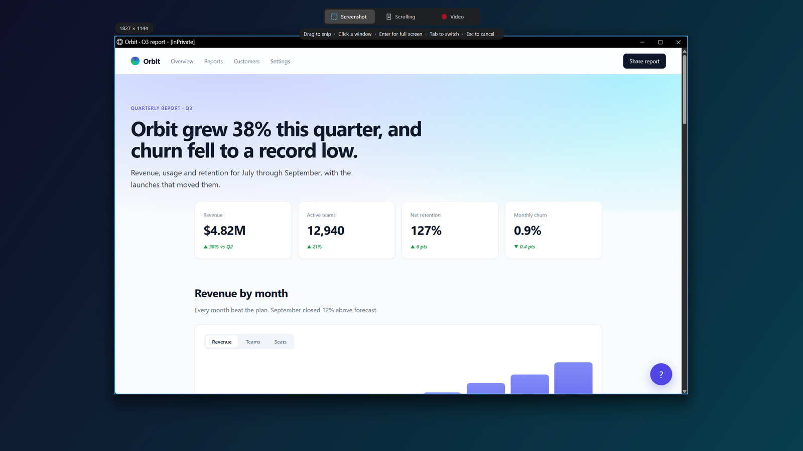
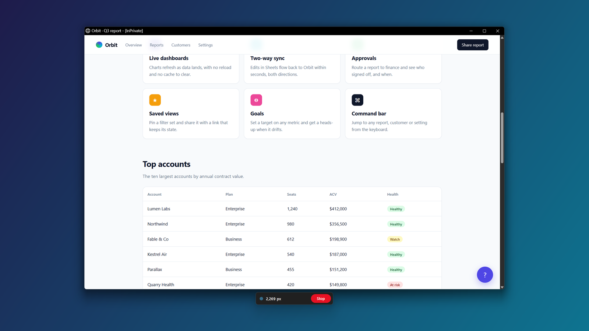
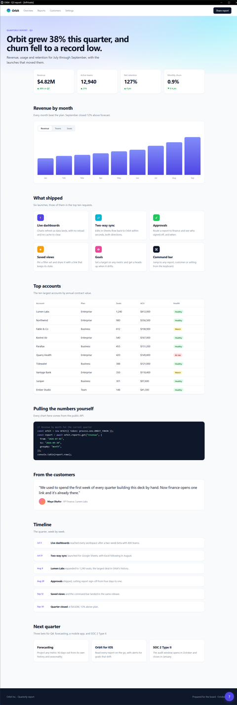
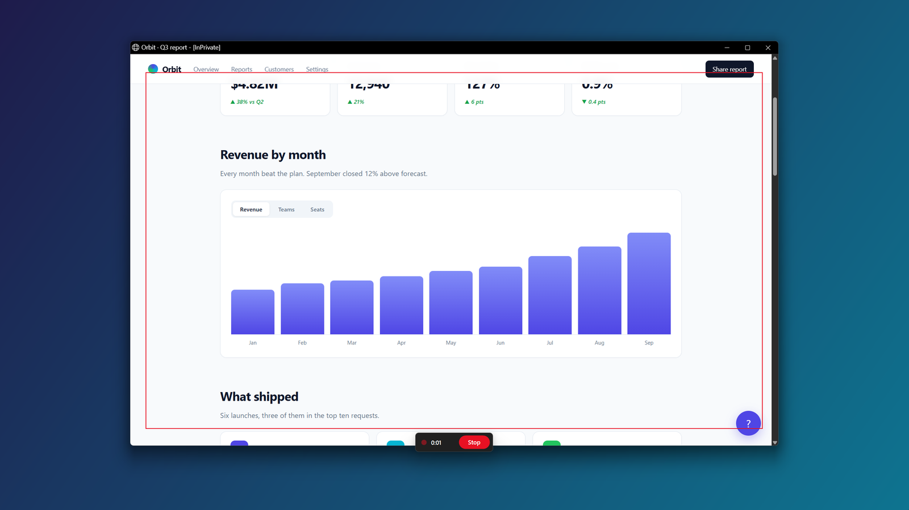
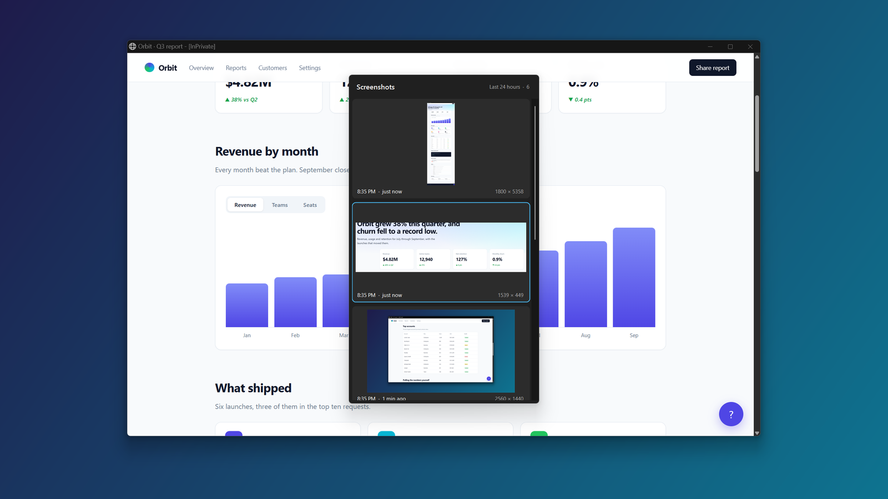

<p align="center"></p>

<h1 align="center">Snip</h1>

<p align="center">A small, fast replacement for the Windows Snipping Tool.<br>
Screenshots, full-page scrolling captures and screen recordings with auto-zoom, all on <kbd>Win</kbd>+<kbd>Shift</kbd>+<kbd>S</kbd>.</p>

<p align="center">
<a href="https://github.com/latinrev/snip/releases/latest"></a>
<a href="https://github.com/latinrev/snip/actions/workflows/build.yml"></a>
<a href="LICENSE"></a>
</p>

<p align="center"><a href="https://latinrev.github.io/snip/"></a><br><sub>Watch the demo: screenshot, scrolling capture, recording with auto-zoom, history.</sub></p>

Snip is one executable of about 120 KB. It has no installer, no runtime to download, no account and no network access. It runs in the tray and takes over the screenshot shortcut, so the keys you already use open Snip instead of the built-in tool.

## Features

**Screenshots.** Press <kbd>Win</kbd>+<kbd>Shift</kbd>+<kbd>S</kbd> and the screen freezes. Drag to capture an area, click to capture the window under the cursor, or press <kbd>Enter</kbd> for the whole monitor. The image is copied to the clipboard and saved as a PNG, and a preview appears in the corner. Click the preview to open the file.



**Scrolling capture.** Switch to Scrolling in the bar at the top of the screen, then drag over a web page or click its window. Snip scrolls the page from top to bottom and stitches the screens into one tall image at full screen resolution, with no scaling. Sticky headers appear once at the top, sticky footers and floating chat buttons once at the bottom, and the scrollbar is trimmed off. It works in any app that scrolls with the mouse wheel. The test suite runs it against a real page in Microsoft Edge.



<details><summary>The stitched result, scaled down</summary>

</details>

**Screen recording with auto-zoom.** Switch to Video, then pick an area, a window or the whole screen. Snip records an H.264 MP4 at 30 frames per second. Each click zooms the video in on the cursor, follows it smoothly, and zooms back out after a few seconds, with a ripple where you clicked. The red outline and the Stop button are hidden from the recording. Press <kbd>Win</kbd>+<kbd>Shift</kbd>+<kbd>S</kbd> again or click Stop to finish. The video is copied to the clipboard as a file, so you can paste it straight into a chat or a folder.



**History.** Press <kbd>Win</kbd>+<kbd>Shift</kbd>+<kbd>A</kbd> for a panel with every PNG saved to your Screenshots folder in the last 24 hours, newest first. Cards load as you scroll. Click one, or pick it with the arrow keys and <kbd>Enter</kbd>, and Snip copies it and pastes it into the app you were using.



**Fits in.** Snip handles multiple monitors with different scaling, uses the same file names and folders as the Snipping Tool, starts with Windows, and stays out of the way in the tray. Its own windows, such as the preview and the history panel, never show up in captures.

## Install

1. Download `Snip.exe` from the [latest release](https://github.com/latinrev/snip/releases/latest).
2. Put it somewhere permanent, such as `%LOCALAPPDATA%\Programs\Snip\Snip.exe`.
3. Run it. A tray icon appears and <kbd>Win</kbd>+<kbd>Shift</kbd>+<kbd>S</kbd> now opens Snip.

Snip adds itself to your startup apps on first run, pointing at wherever the file is. If you move the file later, run it once from the new place. A copy run from a temporary folder, such as straight out of a zip, doesn't add itself.

**Requirements.** 64-bit Windows 10 version 2004 or later, or Windows 11. Version 2004 is the first that can hide the recording outline and Stop button from the video. Snip uses .NET Framework 4.8, which those versions of Windows already include.

**SmartScreen.** The release is not code-signed, so Windows may show "Windows protected your PC" the first time. Click **More info**, then **Run anyway**. You can check the download against the `Snip.exe.sha256` file in the release, or [build it yourself](#build-from-source).

## Shortcuts

| Keys | Action |
| --- | --- |
| <kbd>Win</kbd>+<kbd>Shift</kbd>+<kbd>S</kbd> | Open the capture bar. While recording or scrolling, stop and keep what was captured. |
| <kbd>Print Screen</kbd> | Same as <kbd>Win</kbd>+<kbd>Shift</kbd>+<kbd>S</kbd>. Can be turned off in the tray menu. Snip takes only the key on its own, so <kbd>Alt</kbd>+<kbd>Print Screen</kbd>, <kbd>Win</kbd>+<kbd>Print Screen</kbd> and other combinations keep working as before. |
| <kbd>Win</kbd>+<kbd>Shift</kbd>+<kbd>A</kbd> | Open or close the 24-hour history. |
| <kbd>Esc</kbd> | During a scrolling capture, cancel it and save nothing. |

On the capture screen:

| Input | Action |
| --- | --- |
| Drag | Capture or record the dragged area. |
| Click | Capture or record the window under the cursor (the monitor, over the desktop). |
| <kbd>Enter</kbd> | Capture or record the monitor under the cursor. |
| <kbd>Tab</kbd> | Switch between Screenshot, Scrolling and Video. |
| <kbd>Esc</kbd> or right-click | Cancel. |

The capture bar always opens in Screenshot mode, so the shortcut keeps its usual meaning.

## Tray menu

Left-click the tray icon to open the capture bar. Right-click it for:

- **Snip**, **Record video** (or **Stop recording**) and **Screenshot history**.
- **Open Screenshots folder**.
- **Start with Windows**, on by default.
- **Use the Print Screen key**, on by default. Turn it off if another tool owns Print Screen.
- **Exit**.

## Where files go

| What | Where |
| --- | --- |
| Screenshots and scrolling captures | `Pictures\Screenshots\Screenshot YYYY-MM-DD HHMMSS.png` |
| Recordings | `Videos\Screen Recordings\Screen Recording YYYY-MM-DD HHMMSS.mp4` |
| Log | `%LOCALAPPDATA%\Snip\snip.log` (rolls over at 1 MB) |
| Settings | `HKEY_CURRENT_USER\Software\Snip` |
| Startup entry | `HKEY_CURRENT_USER\Software\Microsoft\Windows\CurrentVersion\Run`, value `Snip` |

Pictures and Videos follow your Windows folder settings, including OneDrive redirection.

## Privacy

Snip makes no network connections and collects no data. Captures go only to the folders above and to your clipboard. The log records file names, capture sizes and errors, never image content or keystrokes. The keyboard hook looks only for its own shortcuts and passes every other key through untouched.

## Uninstall

1. Right-click the tray icon, uncheck **Start with Windows**, and click **Exit**.
2. Delete `Snip.exe`.
3. Optionally delete `%LOCALAPPDATA%\Snip` and the `HKEY_CURRENT_USER\Software\Snip` registry key.

Your screenshots and recordings stay where they are.

## How it works

- **Taking over the shortcut.** Windows reserves <kbd>Win</kbd>+<kbd>Shift</kbd>+<kbd>S</kbd>, so `RegisterHotKey` can't claim it. Snip installs a low-level keyboard hook on its own thread, swallows the key press before the shell sees it, and taps an unassigned key so releasing <kbd>Win</kbd> doesn't open the Start menu.
- **Capture.** The process is per-monitor DPI aware, so every coordinate is a physical pixel. The overlay copies the whole virtual screen once and shows it frozen, so menus and hover states stay as they were when you pressed the keys.
- **Scrolling capture.** Snip scrolls with synthetic mouse-wheel events and waits until the page has stopped moving. It fingerprints each row of pixels and works out how far the page moved by matching rows between frames. Each page row is taken from the frame where it sat nearest the middle of the screen, which drops sticky bars and floating buttons from the seams.
- **Recording.** Frames come from GDI into a shared DIB section. The zoom is a bilinear resample spread across CPU cores, and frames go to the H.264 encoder built into Windows through the Media Foundation sink writer, using the hardware encoder when one is available.

## Build from source

You need the .NET SDK (8 or later) on Windows. It builds the .NET Framework 4.8 executable directly.

```powershell
git clone https://github.com/latinrev/snip
cd snip
dotnet build src/Snip/Snip.csproj -c Release
```

The executable lands in `src/Snip/bin/Release/net48/Snip.exe`. Every push builds and runs the unit tests on GitHub Actions, and pushing a `v*` tag publishes a release with the executable and its SHA-256 checksum.

## Tests

`tests/Snip.Tests` holds xUnit tests for the parts that don't need a screen: the page stitcher against synthetic pages with sticky bars, a scrollbar, dropped wheel notches and blank stretches, the zoom camera, and the bilinear scaler.

```powershell
dotnet test tests/Snip.Tests/Snip.Tests.csproj
```

`tests/e2e` holds PowerShell scripts that drive a real desktop. They press the shortcuts, drag the mouse, read the clipboard and check the saved files. One builds a window with known content and checks that a scrolling capture reproduces it pixel for pixel. Another runs a long test page in a throwaway Edge window. See [tests/e2e/README.md](tests/e2e/README.md) before running them, since they take over the mouse and keyboard while they run.

## Known limitations

- Scrolling capture scrolls whatever is under the cursor, so don't touch the mouse while it runs. Elements that float in the middle of the screen, like a cookie dialog, repeat in the result. Captures stop at about 60 megapixels and at most 40,000 pixels tall, which is about 23,000 pixels for a page 2,560 pixels wide. The limit also ends infinite-scroll pages. A page needs something on screen that moves as it scrolls: a capture stops if a whole screen is blank, or after several screens with almost nothing on them. When a capture ends early, the preview says why.
- Recordings have no audio, and the zoom follows clicks only.
- The history panel lists PNG images, not recordings.
- Windows keeps apps from sending input to apps running as administrator. When an elevated window is in front, the shortcut may open the built-in Snipping Tool instead, scrolling capture can't scroll that window, and the history panel copies the image but can't paste it.
- Taking over the shortcut needs a low-level keyboard hook. Some security tools flag that. Snip does nothing else with the keyboard.

## License

[MIT](LICENSE)
